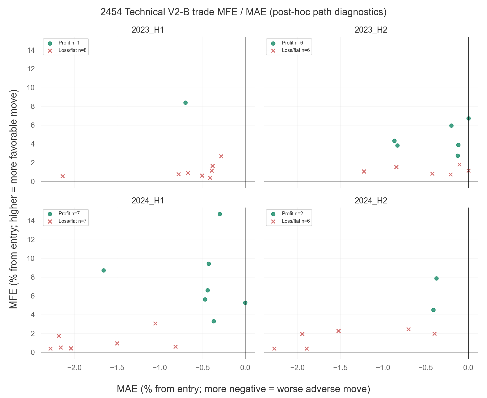
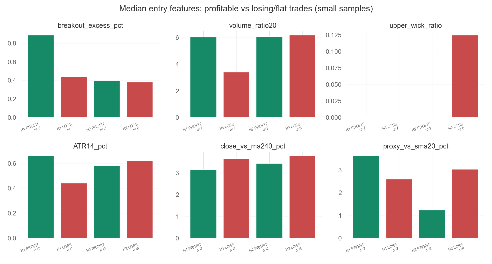
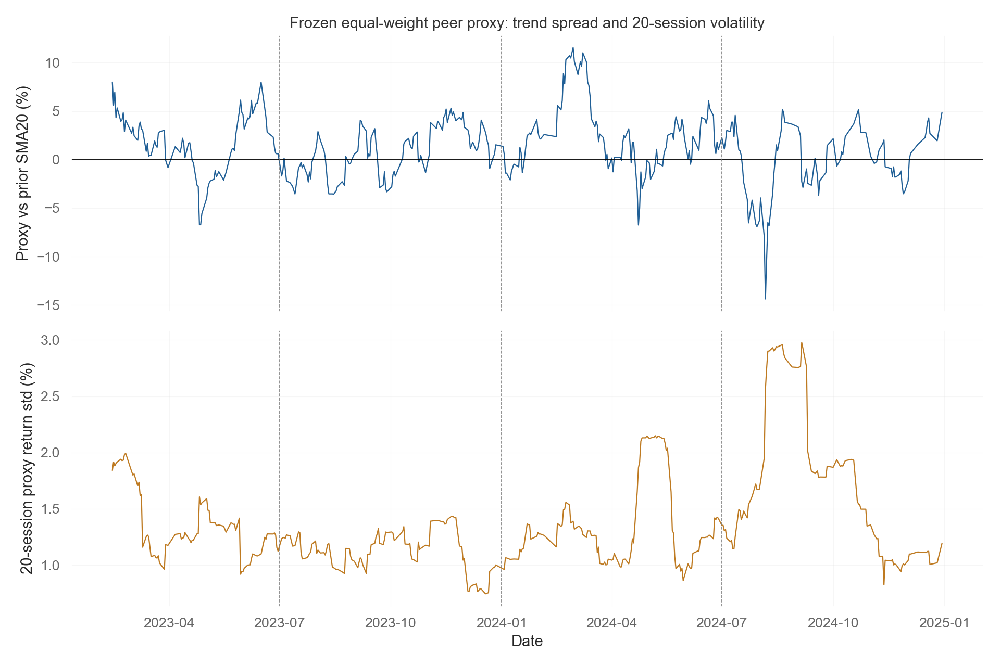

# 2454 聯發科：Technical V2-B 市場狀態與交易績效診斷

## 範圍與方法

- 策略：凍結候選 `BR_SENS_RANGE55_BB20_2` + Risk V1；無 ML Gate。
- 期間：只使用 2023-01-01 至 2024-12-31 historical development；四段為 2023 H1/H2、2024 H1/H2。
- 來源回測：`exports\technical_v2b_cross_stock_exp001_20261104T201723+0800`；股票交易明細及候選訊號取自既有輸出。5 分 K 由 `data\technical_v1_mltech_clean.sqlite3` 以 read-only 方式讀取，SQL 嚴格限定 2023-01-01 至 2024-12-31；沒有讀取其他年份。
- Technical MA、布林及突破線使用現行凍結程式的 `backtest.add_indicators` 計算；ATR14、20 根 5 分 K 波動率、突破幅度、成交量比、上影線比例是事後診斷特徵，沒有進入交易決策。
- 市場代理沿用凍結版本定義：同儕 5 檔等權重絕對收盤價，排除目標股，使用前一個完整共同交易日與前 20 個已完成交易日。此值只作環境比較。
- MFE/MAE 用實際進場至出場成交前的 5 分 K 高低價事後計算；沒有用於建立進場特徵。
- 資料資格沿用來源輸出：Exact 54 real bars、無補值、共同完整日交集。來源 audit 所載共同日期數：422，範圍 2023-01-04 至 2024-12-30。

## 分段績效與交易狀態

績效表中的交易數、成本前後損益及出場數按進場日期分組；半年淨值報酬與最大回撤由既有 equity curve 計算，包含浮動損益。跨半年交易可能造成兩種口徑差異。

| period   |   trades |   win_rate_trade_pct |   gross_pnl |   total_cost |   net_pnl |   profit_factor_net_entry_cohort |   max_drawdown_pct_reset_at_period_start |   median_mfe_pct |   median_mae_pct |   mean_mfe_pct |   mean_mae_pct |   stop_loss_count |   technical_exit_count |   time_expiration_count |
|:---------|---------:|---------------------:|------------:|-------------:|----------:|---------------------------------:|-----------------------------------------:|-----------------:|-----------------:|---------------:|---------------:|------------------:|-----------------------:|------------------------:|
| 2023_H1  |        9 |                11.11 |    13818.00 |     19197.91 |  -5379.91 |                             0.82 |                                     2.12 |             0.94 |            -0.51 |           1.92 |          -0.70 |                 0 |                      8 |                       1 |
| 2023_H2  |       12 |                50.00 |    44224.00 |     27106.80 |  17117.20 |                             1.85 |                                     2.34 |             2.29 |            -0.21 |           2.89 |          -0.41 |                 0 |                     11 |                       1 |
| 2024_H1  |       14 |                50.00 |   103940.62 |     33157.38 |  70783.24 |                             2.25 |                                     4.38 |             3.19 |            -0.94 |           4.39 |          -1.12 |                 3 |                     10 |                       1 |
| 2024_H2  |        8 |                25.00 |   -22934.00 |     19113.43 | -42047.43 |                             0.33 |                                     7.62 |             2.14 |            -1.11 |           2.73 |          -1.19 |                 2 |                      6 |                       0 |

2024 H1 的獲利交易前三筆：
| buy_datetime        | sell_datetime       |   net_pnl | exit_type       |
|:--------------------|:--------------------|----------:|:----------------|
| 2024-02-22 09:20:00 | 2024-02-27 09:20:00 |  53942.27 | time_expiration |
| 2024-05-23 09:10:00 | 2024-05-27 12:30:00 |  23734.23 | technical_exit  |
| 2024-03-06 09:30:00 | 2024-03-08 11:10:00 |  17019.19 | technical_exit  |

2024 H2 的虧損交易前三筆：
| buy_datetime        | sell_datetime       |   net_pnl | exit_type      |
|:--------------------|:--------------------|----------:|:---------------|
| 2024-09-26 10:00:00 | 2024-10-01 09:00:00 | -23208.38 | stop_loss      |
| 2024-10-23 09:45:00 | 2024-10-24 09:00:00 | -12903.16 | stop_loss      |
| 2024-12-03 09:05:00 | 2024-12-03 10:50:00 |  -9630.03 | technical_exit |

## 訊號漏斗與突破形態

| period   |   raw_breakout_triggers |   technical_candidates |   market_pass_candidates |   filled_signals |   median_close_vs_ma120_pct |   median_close_vs_ma240_pct |   median_ma20_slope12_pct |   median_ma60_slope12_pct |   median_ma120_slope12_pct |   median_ma240_slope12_pct |   median_breakout_excess_pct |   median_volume_ratio20 |   median_upper_wick_ratio |   median_atr14_pct |   median_hv20_5m_pct |   median_proxy_vs_sma20_pct |   median_proxy_return_20d_pct |   median_proxy_volatility_20d_pct |
|:---------|------------------------:|-----------------------:|-------------------------:|-----------------:|----------------------------:|----------------------------:|--------------------------:|--------------------------:|---------------------------:|---------------------------:|-----------------------------:|------------------------:|--------------------------:|-------------------:|---------------------:|----------------------------:|------------------------------:|----------------------------------:|
| 2023_H1  |                      90 |                     31 |                       24 |                9 |                        1.62 |                        1.83 |                      0.36 |                      0.18 |                       0.07 |                       0.11 |                         0.26 |                    2.23 |                      0.00 |               0.33 |                 0.27 |                        1.67 |                          3.55 |                              1.36 |
| 2023_H2  |                      99 |                     48 |                       37 |               12 |                        1.72 |                        1.90 |                      0.24 |                      0.21 |                       0.14 |                       0.09 |                         0.24 |                    3.19 |                      0.00 |               0.29 |                 0.23 |                        1.12 |                          2.09 |                              1.16 |
| 2024_H1  |                      94 |                     54 |                       45 |               14 |                        2.71 |                        3.39 |                      0.41 |                      0.34 |                       0.26 |                       0.21 |                         0.45 |                    3.36 |                      0.00 |               0.60 |                 0.40 |                        2.95 |                          4.94 |                              1.33 |
| 2024_H2  |                      63 |                     23 |                       12 |                8 |                        2.67 |                        2.63 |                      0.49 |                      0.31 |                       0.07 |                       0.08 |                         0.40 |                    3.30 |                      0.00 |               0.60 |                 0.42 |                        0.02 |                         -1.04 |                              1.78 |

候選訊號特徵是在訊號 K 收盤後可得。MA 斜率用最近 12 根 5 分 K 的相對變化；ATR14 是最近 14 根 5 分 K 真實波幅簡單平均；HV20 是最近 20 根 5 分 K 收盤報酬標準差。它們是描述性量，不是新增策略條件。

## H1 / H2 的進場時點特徵對照

上表涵蓋各期原始候選（含之後未成交者）的中位數。市場代理趨勢與波動使用訊號日前已完成的代理資料。

## 獲利與虧損交易特徵比較

以下僅列 2024 H1/H2 的成交交易，樣本數每組很小；均值/中位數差異不能視為統計顯著，也不代表因果。

| period   | trade_outcome   |   n |   breakout_excess_pct_mean |   breakout_excess_pct_median |   volume_ratio20_mean |   volume_ratio20_median |   upper_wick_ratio_mean |   upper_wick_ratio_median |   ATR14_pct_mean |   ATR14_pct_median |   HV20_5m_pct_mean |   HV20_5m_pct_median |   close_vs_ma20_pct_mean |   close_vs_ma20_pct_median |   close_vs_ma60_pct_mean |   close_vs_ma60_pct_median |   close_vs_ma120_pct_mean |   close_vs_ma120_pct_median |   close_vs_ma240_pct_mean |   close_vs_ma240_pct_median |   ma20_slope12_pct_mean |   ma20_slope12_pct_median |   ma60_slope12_pct_mean |   ma60_slope12_pct_median |   ma120_slope12_pct_mean |   ma120_slope12_pct_median |   ma240_slope12_pct_mean |   ma240_slope12_pct_median |   proxy_vs_sma20_pct_mean |   proxy_vs_sma20_pct_median |   proxy_return_20d_pct_mean |   proxy_return_20d_pct_median |   proxy_volatility_20d_pct_mean |   proxy_volatility_20d_pct_median |
|:---------|:----------------|----:|---------------------------:|-----------------------------:|----------------------:|------------------------:|------------------------:|--------------------------:|-----------------:|-------------------:|-------------------:|---------------------:|-------------------------:|---------------------------:|-------------------------:|---------------------------:|--------------------------:|----------------------------:|--------------------------:|----------------------------:|------------------------:|--------------------------:|------------------------:|--------------------------:|-------------------------:|---------------------------:|-------------------------:|---------------------------:|--------------------------:|----------------------------:|----------------------------:|------------------------------:|--------------------------------:|----------------------------------:|
| 2024_H1  | LOSS_OR_FLAT    |   7 |                      1.029 |                        0.439 |                 5.041 |                   3.392 |                   0.094 |                     0.000 |            0.462 |              0.440 |              0.414 |                0.385 |                    1.802 |                      1.808 |                    2.233 |                      2.034 |                     3.371 |                       3.653 |                     4.472 |                       3.664 |                   0.310 |                     0.411 |                   0.461 |                     0.337 |                    0.341 |                      0.385 |                    0.228 |                      0.185 |                     4.383 |                       2.594 |                       6.831 |                         4.459 |                           1.215 |                             1.231 |
| 2024_H1  | PROFIT          |   7 |                      1.130 |                        0.889 |                 6.477 |                   6.045 |                   0.151 |                     0.000 |            0.622 |              0.661 |              0.478 |                0.381 |                    1.883 |                      1.680 |                    2.320 |                      2.044 |                     2.827 |                       2.466 |                     3.387 |                       3.155 |                   0.214 |                     0.072 |                   0.259 |                     0.213 |                    0.160 |                      0.155 |                    0.203 |                      0.176 |                     4.332 |                       3.628 |                       6.618 |                         5.930 |                           1.519 |                             1.334 |
| 2024_H2  | LOSS_OR_FLAT    |   6 |                      0.381 |                        0.382 |                 5.674 |                   6.184 |                   0.139 |                     0.125 |            0.637 |              0.620 |              0.419 |                0.417 |                    1.595 |                      1.641 |                    2.136 |                      2.070 |                     3.144 |                       3.334 |                     4.217 |                       3.784 |                   0.314 |                     0.220 |                   0.451 |                     0.582 |                    0.381 |                      0.281 |                    0.182 |                      0.152 |                     2.553 |                       3.032 |                       2.509 |                         0.617 |                           1.599 |                             1.707 |
| 2024_H2  | PROFIT          |   2 |                      0.395 |                        0.395 |                 6.072 |                   6.072 |                   0.000 |                     0.000 |            0.581 |              0.581 |              0.587 |                0.587 |                    2.349 |                      2.349 |                    2.692 |                      2.692 |                     2.668 |                       2.668 |                     3.437 |                       3.437 |                   0.265 |                     0.265 |                  -0.003 |                    -0.003 |                    0.104 |                      0.104 |                    0.214 |                      0.214 |                     1.242 |                       1.242 |                      -2.554 |                        -2.554 |                           2.028 |                             2.028 |

## 出場原因

| period   | exit_type       |   trade_count |   winners |   gross_pnl |     fees |      tax |   total_cost |   net_pnl |   median_net_pnl |   win_rate_pct |
|:---------|:----------------|--------------:|----------:|------------:|---------:|---------:|-------------:|----------:|-----------------:|---------------:|
| 2023_H1  | technical_exit  |             8 |         0 |   -13279.00 |  9052.96 |  7718.45 |     16771.41 | -30050.41 |         -3028.65 |           0.00 |
| 2023_H1  | time_expiration |             1 |         1 |    27097.00 |  1162.34 |  1264.16 |      2426.49 |  24670.51 |         24670.51 |         100.00 |
| 2023_H2  | technical_exit  |            11 |         5 |    36510.00 | 12603.77 | 12115.17 |     24718.94 |  11791.06 |         -1290.08 |          45.45 |
| 2023_H2  | time_expiration |             1 |         1 |     7714.00 |  1157.68 |  1230.18 |      2387.86 |   5326.14 |          5326.14 |         100.00 |
| 2024_H1  | stop_loss       |             3 |         0 |   -31768.38 |  3576.32 |  3102.39 |      6678.72 | -38447.09 |        -12846.75 |           0.00 |
| 2024_H1  | technical_exit  |            10 |         6 |    79193.00 | 11879.23 | 12025.70 |     23904.94 |  55288.06 |          3958.10 |          60.00 |
| 2024_H1  | time_expiration |             1 |         1 |    56516.00 |  1212.57 |  1361.16 |      2573.73 |  53942.27 |         53942.27 |         100.00 |
| 2024_H2  | stop_loss       |             2 |         0 |   -31254.00 |  2389.33 |  2468.21 |      4857.54 | -36111.54 |        -18055.77 |           0.00 |
| 2024_H2  | technical_exit  |             6 |         2 |     8320.00 |  7236.25 |  7019.64 |     14255.89 |  -5935.89 |         -4095.53 |          33.33 |

## MFE / MAE

MFE 是持倉期間最高價相對進場價的最大有利幅度；MAE 是最低價相對進場價的最大不利幅度。若 MFE 高但實際獲利低，表示持倉期間曾出現較佳浮盈但最終未完全保留；這不能單獨證明應延長持有或更改出場。

## 市場代理趨勢與波動

月份資料：`market_regime_monthly.csv`。代理是原策略的等權重絕對股價代理，不是市場指數報酬率；不同股票名目價格可能影響代理尺度，解讀需保留此限制。

## 已有數據支持的發現

1. **結果方向反轉。**2024 H1 有 14 筆、勝率 50.0%、淨損益 NT$70,783；H2 有 8 筆、勝率 25.0%、淨損益 NT$-42,047。H1 成本前毛損益 NT$103,941、成本 NT$33,157；H2 毛損益已是 NT$-22,934，再扣 NT$19,113。
2. **H2 虧損集中在兩筆停損。**H2 有 2 筆停損，合計淨損益 NT$-36,112，約占該段淨虧損金額 85.9%；6 筆技術出場合計 NT$-5,936。H1 有 3 筆停損合計 NT$-38,447，但技術出場 10 筆合計 +NT$55,288，另 1 筆時間到期交易 +NT$53,942。
3. **突破幅度與量比沒有顯示 H2 明顯較弱。**候選突破超越幅度中位數 H1 0.447%、H2 0.403%；量比 3.36 對 3.30。但 H2 的 ATR% 0.602% 高於 H1 0.595%，HV20 0.424% 高於 H1 0.399%。這或許代表較躁動，但需更多資料驗證。
4. **長期趨勢與代理市場環境在 H2 較弱。**候選收盤價高於 MA240 的中位幅度由 H1 3.39% 降至 H2 2.63%；MA120 斜率由 0.258% 降至 0.074%（仍為正）。凍結代理相對 SMA20 由 2.95% 降到 0.02%；20 日代理變化由 4.94% 降到 -1.04%，代理波動度則由 1.33% 升至 1.78%。這些與結果同時變化，不證明因果。
5. **進場後延續性偏弱。**實際成交的 MFE 中位數 H1 3.19%、H2 2.14%；H2 平均 MAE -1.19%，H1 為 -1.12%。H2 僅 8 筆交易，這是樣本描述，不足以推論普遍規律。
6. **可用候選也變少。**H1 有 54 筆技術候選、45 筆通過市場代理；H2 分別 23 與 12 筆。這說明 H2 機會較少且既有濾網擋下更多候選，不代表濾網造成虧損。
7. 來源回測使用完成 K 棒後、下一根實際可交易 K 棒開盤成交；市場代理只取前一完整共同交易日。MFE/MAE 是事後行情路徑，不參與訊號特徵。

## 可能原因與尚待驗證的假設

- **可能原因：**H2 的部分突破可能在較差的市場代理/波動條件下出現，或突破後延續不足；若 H2 虧損交易在突破幅度、上影線、ATR/波動、代理趨勢或 MFE/MAE 上與 H1 呈現一致差異，這些可作後續研究假設。
- **尚待驗證：**四個半年及 2024 H2 的 8 筆交易太少，無法證明某一特徵造成虧損；年度市場報酬與策略報酬的同步/反向也不是因果證據。市場代理的絕對價格等權規則本身可能限制其經濟解釋。
- **不支持的結論：**不能把本次歷史中較賺錢的特徵門檻直接改成進場規則，也不能因 2024 H1 表現好就宣稱策略已穩定。

## 總結回答

V2-B 在 2024 H1 獲利、H2 虧損，直接可確認的是成交樣本數、勝率、成本前損益、交易成本、出場組成和各項訊號/市場特徵描述不同。H2 成本前已虧損，故交易成本加重結果但不是唯一原因。若特徵比較顯示 H2 的突破品質或市場代理狀態較弱，合理說法是「與較差交易結果相關的候選解釋」，不能說已證明因果。下一步應在不改規則下，擴大其他股票與預先規劃的前瞻期間驗證，並用真實執行滑價重做風險敏感度。

## 治理旗標

`data_period = 2023-01-01..2024-12-31`  
`data_role = historical_development_exposed`  
`2025_used = false`  
`2026_used = false`  
`holdout_or_final_oos_used = false`  
`backtest_rerun = false`  
`strategy_or_risk_changed = false`  
`parameter_search = false`
